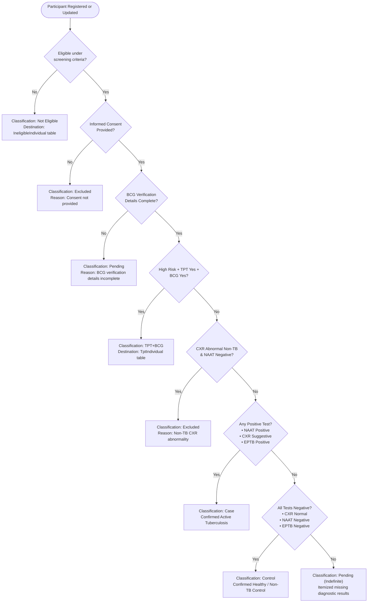

# Participant Classification & Eligibility Rules Engine

**Document Version:** 1.1 (Updated: 30-Day Pending Expiry Rule Removed)  
**Target Codebase Location:** [`abcg_project/questions/views.py`](file:///c:/Users/IPEGlobal60/Desktop/abcg_training_application/abcg_ontraining/abcg_project/questions/views.py#L995-L1170)  
**Database Models:** [`Participant`](file:///c:/Users/IPEGlobal60/Desktop/abcg_training_application/abcg_ontraining/abcg_project/questions/models.py#L180), [`TptIndividual`](file:///c:/Users/IPEGlobal60/Desktop/abcg_training_application/abcg_ontraining/abcg_project/questions/models.py#L460), [`IneligibleIndividual`](file:///c:/Users/IPEGlobal60/Desktop/abcg_training_application/abcg_ontraining/abcg_project/questions/models.py#L640)  

---

## 1. Overview & Purpose

The **Eligibility & Clinical Classification Engine** automatically evaluates each screened individual during registration (and upon clinical record updates) to categorize them into one of the primary study cohorts:

1. **`Case`** – Confirmed Active Tuberculosis (Pulmonary or Extra-Pulmonary).
2. **`Control`** – Confirmed Healthy / Non-TB Control.
3. **`TPT+BCG`** – Exploratory Cohort: High-risk individual with BCG vaccination and TPT chemoprophylaxis history.
4. **`Pending`** – Investigation or verification data pending (CXR, NAAT, EPTB, or BCG verification details). **Participants with pending tests are NEVER excluded based on elapsed time (even $\ge 30$ days), ensuring diagnostic delays never cause improper disqualification.**
5. **`Excluded`** – Ineligible for study analysis (consent declined or non-TB radiological pathology with negative NAAT).
6. **`Not Eligible`** – Did not meet preliminary screening criteria (age $< 18$, outside study TB Unit, or no high-risk criteria).

---

## 2. Input Diagnostic Signals

The engine processes 7 primary input signals before evaluating the decision hierarchy:

| Signal | Source Field(s) | Possible Internal Values | Clinical Interpretation |
| :--- | :--- | :--- | :--- |
| **1. Screening Eligibility** | Preliminary Screening Steps 1–4 | `True` / `False` | Age $\ge 18$, lives in study site/TB Unit, belongs to target high-risk groups. |
| **2. Informed Consent** | Step 4: `consent` | `"Yes"` / `"No"` | Whether participant agreed to provide informed consent. |
| **3. TPT + BCG Profile** | `has_hrg`, `eligible_bcg_campaign`, `tpt_undergone`, `bcg_status` | `True` / `False` | Belongs to HRG, eligible for campaign, underwent TPT, and was vaccinated with BCG. |
| **4. BCG Completeness** | `bcg_status`, `bcg_vaccination_date`, `bcg_batch_number`, `bcg_facility` | `True` / `False` | `True` if `bcg_status == "No"` OR if `Yes` with date, batch number, and facility present. |
| **5. Pulmonary NAAT (MCTB)** | `final_interpretation` or `naat_status` | `POSITIVE`, `NEGATIVE`, `PENDING` | Detected/Rif Resistant/Sensitive vs Not Detected/Negative vs unperformed/blank. |
| **6. Chest X-Ray (CXR)** | `cxr_done`, `cxr_result`, `cxr_status` | `SUGGESTIVE_OF_TB`, `ABNORMAL_NON_TB`, `NORMAL`, `NOT_DONE`, `PENDING` | CXR suggestive of TB vs non-TB abnormality vs normal (or unperformed in asymptomatic). |
| **7. Extra-Pulmonary TB (EPTB)** | `eptb_answers` (symptoms & site investigations) | `POSITIVE`, `NEGATIVE`, `PENDING` | Positive at any site vs all investigated negative / no symptoms vs symptoms with pending tests. |

---

## 3. Decision Hierarchy & Classification Rules

The rules are evaluated in **strict sequential order of precedence**. The first rule whose condition evaluates to `True` assigns the classification and terminates further evaluation.

```
Rule 1: Screening Ineligibility  ──► "Not Eligible"
Rule 2: Consent Declined         ──► "Excluded"
Rule 3: Incomplete BCG Details   ──► "Pending"
Rule 4: TPT + BCG Cohort Check   ──► "TPT+BCG"
Rule 5: Non-TB CXR Pathology     ──► "Excluded"
Rule 6: Confirmed TB Case        ──► "Case"
Rule 7: Healthy / Non-TB Control ──► "Control"
Rule 8: Default Fallthrough      ──► "Pending" (indefinite, with dynamic itemized reason)
```

---

### Rule 1: Screening Ineligibility
* **Condition:** `not eligible` (participant failed age, residency, or HRG criteria).
* **Assigned Classification:** `Not Eligible`
* **Assigned Reason:** `"Participant is ineligible under screening criteria."`
* **Storage Destination:** [`IneligibleIndividual`](file:///c:/Users/IPEGlobal60/Desktop/abcg_training_application/abcg_ontraining/abcg_project/questions/models.py#L640) table.

---

### Rule 2: Consent Declined
* **Condition:** `consent_declined == True` (`consent == "No"`).
* **Assigned Classification:** `Excluded`
* **Assigned Reason:** `"Excluded from Study: Informed consent not provided"`
* **Action:** Clears clinical diagnostic answers; sets `ptb_screened = False`, `eptb_screened = False`, `bcg_status = "No"`.
* **Storage Destination:** [`Participant`](file:///c:/Users/IPEGlobal60/Desktop/abcg_training_application/abcg_ontraining/abcg_project/questions/models.py#L180) table with `eligible = False`.

---

### Rule 3: Incomplete BCG Verification Details
* **Condition:** `not bcg_complete`  
  *(Occurs when participant answered `bcg_status == "Yes"` but vaccination date, batch number, or facility name was left blank).*
* **Assigned Classification:** `Pending`
* **Assigned Reason:** `"One or more required BCG verification or vaccine details are incomplete."`
* **Storage Destination:** [`Participant`](file:///c:/Users/IPEGlobal60/Desktop/abcg_training_application/abcg_ontraining/abcg_project/questions/models.py#L180) table.

---

### Rule 4: TPT + BCG Exploratory Cohort
* **Condition:** `is_tpt_bcg == True`  
  *(Criteria: High-Risk Group + BCG campaign eligible + `tpt_undergone == "Yes"` + `bcg_status == "Yes"` + consent provided).*
* **Assigned Classification:** `TPT+BCG`
* **Assigned Reason:** `"Eligible for BCG + TPT Exploratory Cohort"`
* **Storage Destination:** [`TptIndividual`](file:///c:/Users/IPEGlobal60/Desktop/abcg_training_application/abcg_ontraining/abcg_project/questions/models.py#L460) table.

---

### Rule 5: Non-TB CXR Pathology Exclusion
* **Condition:** `cxr == "ABNORMAL_NON_TB"` AND `mctb == "NEGATIVE"`.
* **Assigned Classification:** `Excluded`
* **Assigned Reason:** `"Abnormal CXR not suggestive of TB with NAAT Negative"`
* **Clinical Note:** Radiographic abnormality unrelated to TB combined with negative microbiology excludes the subject from both Case and Control definitions.

---

### Rule 6: Confirmed Active Tuberculosis (`Case`)
* **Condition:** Any ONE of the following is `True`:
  1. `mctb == "POSITIVE"` (NAAT / CBNAAT / Truenat / MCTB Detected)
  2. `cxr == "SUGGESTIVE_OF_TB"` (Chest radiograph suggestive of TB)
  3. `eptb_status == "POSITIVE"` (Biopsy, smear, NAAT, or imaging positive for EPTB)

* **Assigned Classification:** `Case`
* **Granular Reason Assigned:**
  - Both NAAT Positive & CXR Suggestive: `"MCTB Positive and CXR suggestive of TB"`
  - NAAT Positive & Normal CXR: `"MCTB Positive and Normal CXR"`
  - NAAT Positive only: `"MCTB Positive"`
  - CXR Suggestive & NAAT Negative: `"CXR suggestive of TB with MCTB Negative"`
  - CXR Suggestive only: `"Chest X-Ray suggestive of TB"`
  - EPTB Positive: `"EPTB Investigation Positive"`
* **Storage Destination:** [`Participant`](file:///c:/Users/IPEGlobal60/Desktop/abcg_training_application/abcg_ontraining/abcg_project/questions/models.py#L180) table.

---

### Rule 7: Healthy / Non-TB Control (`Control`)
* **Condition:** ALL THREE of the following must be `True`:
  1. `cxr == "NORMAL"` (Normal radiograph, or asymptomatic participant with no CXR indicated)
  2. `mctb == "NEGATIVE"` (NAAT / MCTB Not Detected)
  3. `eptb_status == "NEGATIVE"` (No EPTB symptoms reported, or all symptom investigations confirmed negative)

* **Assigned Classification:** `Control`
* **Assigned Reason:** `"Normal CXR, Negative NAAT, and Negative EPTB status"`
* **Storage Destination:** [`Participant`](file:///c:/Users/IPEGlobal60/Desktop/abcg_training_application/abcg_ontraining/abcg_project/questions/models.py#L180) table.

---

### Rule 8: Default Fallthrough (`Pending`)
* **Condition:** Does not meet Case or Control criteria because one or more diagnostic tests are unperformed, blank, or pending.
* **Duration Policy:** **Indefinite.** Participants remain in `Pending` regardless of time elapsed ($\ge 30$ days, 60 days, etc.) until diagnostic results are submitted or overridden by a doctor.
* **Assigned Classification:** `Pending`
* **Dynamic Itemized Reasons Generated:**
  - **NAAT Pending:**
    - Testing not undergone: `"NAAT (MCTB) is pending because clinical testing has not been undergone"`
    - Result unrecorded: `"NAAT (MCTB) is pending because test result is blank or not recorded"`
  - **CXR Pending:**
    - CXR not performed: `"Chest X-Ray has not been performed"`
    - Findings unrecorded: `"Chest X-Ray is pending because interpretation findings are blank or not recorded"`
    - Other CXR pending: `"Chest X-Ray investigation is pending"`
  - **EPTB Pending:**
    - Symptoms present but tests missing: `"EPTB is pending because investigation results are not recorded for presumptive EPTB investigation"`
    - Site tests pending: `"EPTB is pending because investigation results are not recorded for <Site Name(s)>"`

---

## 4. Visual Decision Flowchart



---

## 5. Downstream Workflows & Clinical Overrides

1. **Doctor Clinical Override (`doctor_verify` view):**
   - Authorized roles (`Super Admin`, `Admin`, `Doctor`) can access the clinical verification queue and manually override any participant's classification with an audit-logged clinical rationale.
2. **Reconciliation Module (`reconcile.html`):**
   - Allows site coordinators to compare local aBCG records against Nikshay / Central Registry data for name, age, phone, BCG status, BCG date, BCG scar, and TB classification, marking records as `FULLY_RECONCILED` or `PARTIALLY_RECONCILED`.
3. **Data Quality & Reporting (`data_export_view`):**
   - Both the active `classification` and underlying `classification_reason` are exported to CSV and Excel reports.
